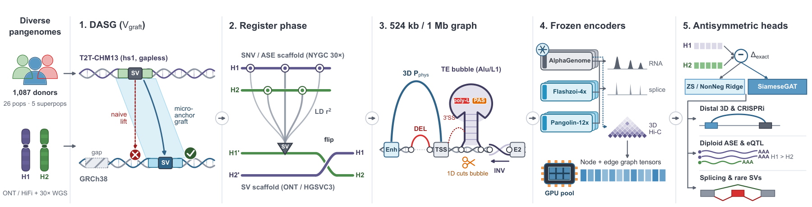

# PanPrism

[](LICENSE)

`panprism` is the Python package and command-line toolkit accompanying *"PanPrism predicts regulatory and splicing effects of structural variants across human pangenomes"*. It projects long-read pangenome structural variants onto frozen megabase-scale DNA sequence models without retraining backbone weights.



## Repository structure

- `src/panprism/`: Core package implementing cross-assembly syntenic grafting (`assembly_validator.py`, `dasg.py`), DNA-only LD haplotype phase registration (`phase_registration.py`), breakpoint-graph construction and on-GPU pooling (`breakpoint_graph.py`, `gfa_parser.py`), physical 3D contact normalization and coverage unsquashing (`contact_physics.py`), multi-backbone sequence-to-function runners (`s2f_runners.py`), antisymmetric linear couplers (`coupler.py`, `model_selection.py`, `finemap.py`), Siamese graph attention readouts (`siamese_gat.py`), and the `panprism` CLI (`cli.py`).
- `examples/`: Self-contained CPU quickstart script (`quickstart_demo.py`).
- `scripts/`: End-to-end CLI workflow documentation for full cohort runs.
- `docs/`: Public cohort accession list and pretrained checkpoint licensing table (`datasets_and_models.md`).
- `tests/`: Unit and algebraic-invariance test suite (`pytest`).

## System requirements

- **Operating system:** Linux (tested on Ubuntu 22.04) or macOS (tested on macOS 14/15).
- **Python:** Python 3.10 or newer (`numpy >= 1.24`, `scipy >= 1.10`, `pandas >= 2.0`, `pyarrow >= 14.0`).
- **Hardware:**
  - Core utilities (`verify-assembly`, `register-phase`, `couple`, `finemap`, unit tests, and the quickstart demo) run on any standard CPU workstation with >= 8 GB RAM.
  - Full-context neural inference (`panprism infer`) requires a CUDA-enabled GPU (tested on NVIDIA GPUs with >= 24 GB VRAM for 524 kb / 1 Mb windows) and optional `torch >= 2.2` dependencies.

## Installation

Typical installation on a desktop or workstation takes under 1 minute:

```bash
git clone https://github.com/sdetw463/panprism.git
cd panprism
pip install -e .
```

Optional extras for VCF/FASTA/liftover I/O, GPU foundation-model inference, and running tests:

```bash
pip install -e ".[genomics,gpu,dev]"
```

## Quickstart demo

A self-contained CPU demo (`examples/quickstart_demo.py`) exercises syntenic grafting, DNA-only LD phase registration, breakpoint-graph projection with an unclipped 200-bp insertion bubble, diagonal-normalized physical 3D contact probabilities, open-source feature masking, and antisymmetric grouped Ridge regression on synthetic inputs without downloading external datasets or weights.

```bash
python examples/quickstart_demo.py
```

Expected output (runtime ~0.05 s on a standard CPU):

```text
[1] Syntenic grafting: passed=True, tier=tier2_vgraft, grch38_span=[250, 310), grafted_alt_len=1 bp
[2] LD phase registration: pre-reg concordance=0.328 -> post-reg concordance=1.000
[3] Breakpoint graph: seq_len=8192 bp, insertion_bubbles=1, bubble_len=200 bp
[4] 3D contact physics: min(P_phys)=2.848e-02 (>0 across negative log O/E), unsquashed_sample=[1.976, 12.547, 107.277]
[5] Open-source mode & antisymmetric Ridge: active_open_channels=5/29, max|f(H1,H2)+f(H2,H1)|=0.0e+00, max|f(H,H)|=0.0e+00
Demo finished in 0.01 s.
```

To run the full unit test suite:

```bash
pytest
```

## Command-line usage

Installing the package exposes five subcommands under `panprism`:

```bash
# 1. Cross-assembly T2T-CHM13v2.0 (hs1) -> GRCh38 verification and syntenic grafting
panprism verify-assembly \
  --input svs.vcf.gz \
  --fasta hg38.fa \
  --hs1-fasta hs1.fa \
  --chain hs1ToHg38.over.chain.gz \
  --output verified.json

# 2. DNA-only LD haplotype scaffold polarity registration
panprism register-phase \
  --input-npz cohort_genotypes.npz \
  --output-npz registered_haplotypes.npz

# 3. Breakpoint-graph sequence-to-function inference
#    Default open-source mode (Flashzoi-4x + Pangolin-12x; no AlphaGenome weights):
panprism infer --manifest-json loci.json --mode mit --output pooled_open.npz
#    Full multi-backbone mode (adds AlphaGenome 262 kb / 524 kb / 1 Mb + 3D contacts):
panprism infer --manifest-json loci.json --mode full --window-len 524288 --output pooled_full.npz

# 4. Chromosome-grouped diploid allelic coupling with permuted-label null check
panprism couple --input-npz het_sv_ase.npz --null-seeds 20 --output ase_metrics.json

# 5. Rare and singleton SV outlier prioritization
panprism finemap --input-parquet outlier_windows.parquet --output prioritized_svs.parquet
```

## Reproducing manuscript analyses

All datasets analyzed in the paper (1KG_ONT_VIENNA, HPRC Releases 1–2, HGSVC3, NYGC 30x 1kGP, MAGE, Geuvadis, GTEx v8/v10, Chiang et al. 2017, ClinVar, ENCODE-rE2G, 4D Nucleome, and ENCODE4 lentiMPRA) are publicly available. Accession numbers and pretrained checkpoint identifiers are listed in [`docs/datasets_and_models.md`](docs/datasets_and_models.md), and workflow notes are in [`scripts/WORKFLOWS.md`](scripts/WORKFLOWS.md).

## Licensing

- **Code (`panprism`):** Released under the MIT License ([`LICENSE`](LICENSE)).
- **Pretrained model weights:** Governed by their respective upstream licenses. Default open-source mode (`--mode mit`) combines MIT-licensed Flashzoi-524kb replicates with GPL-3.0-licensed Pangolin-12x checkpoints and masks all AlphaGenome channels and peak coordinates to zero. Optional `--mode full` execution additionally uses AlphaGenome-450M under the Google DeepMind AlphaGenome Non-Commercial Research Terms of Use. See [`docs/datasets_and_models.md`](docs/datasets_and_models.md) for details.

## Citation

If you use `panprism` in your research, please cite:

> *PanPrism predicts regulatory and splicing effects of structural variants across human pangenomes* (manuscript under review, 2026).

See [`CITATION.cff`](CITATION.cff) for machine-readable software citation metadata.
